# Spendwise Desk

A support and policy desk for expense claims at small Indian companies. Employees ask questions and log expenses by voice. Every answer is cited, checked against the expense policy in code, and approved by a person before anything is saved. Each week the system groups what people are confused about into a short pulse for the finance team. Once a canonical explainer is approved, the assistant reuses it.

Built on [Spendwise](https://github.com/Daminigit/Spendwise) v1 (expense claims run from Claude over MCP).

- **Prototype:** _add the Render URL here after deploying (see [Deploy](#deploy))_
- **Evals:** [`evals/RESULTS.md`](evals/RESULTS.md): 19/19 required checks pass against the live model (Groq gpt-oss + Whisper)
- **Demo logins** (password `demo1234`): `riya@acme.test` (employee), `manager@acme.test` (manager), `admin@acme.test` (admin / finance)

---

## The brief, mapped to this product

The brief was written for an investment platform. Our instructor allowed any product that meets the rubric, so this is how each part of the brief maps onto expense claims:

| In the brief | In Spendwise Desk |
|---|---|
| Official documents / FAQ corpus | The company's expense policy (read live from the database) plus CBIC's GST tax-invoice rules ([Sources](#sources)) |
| Reviews CSV | One week of questions people asked the assistant, plus claim lines that were flagged or rejected ([`evals/samples/weekly-inputs.csv`](evals/samples/weekly-inputs.csv)) |
| Fee or charge confusion | Policy-rule confusion: which bills need a supplier GSTIN, hotel and meal limits, weekend spend |
| User questions queue | Spoken or typed messages to the Assistant, plus `ask_policy` calls from the employee's own Claude |
| Reply draft with citation | A cited answer of three sentences or fewer, or a preview card for an action (add expense, approve, reject) |
| Product team | Finance / admins |
| Doc append, email draft | Weekly Log entry, and a saved email draft that is never sent |
| No buy/sell, returns or PII | No investment, tax-planning or returns advice; PAN, Aadhaar, card, phone, account, email and UPI are redacted everywhere |

---

## Architecture

```mermaid
flowchart LR
  subgraph In["Response loop"]
    MIC["Mic"] --> WH["Whisper on Groq<br/>(speech → text)"] --> V["Text<br/>/assistant"]
    V --> G1{"Advice guard<br/>(code)"}
    M["Employee's Claude<br/>MCP ask_policy"] --> G1
    G1 -- refused --> R["Refusal"]
    G1 --> X["Model: intent + fields<br/>(strict JSON, checked in code)"]
    X --> C1["Code: validate, ask for missing,<br/>policy checks, preview"]
    X --> P["Policy question"]
    P --> S["Keyword search<br/>over corpus (code)"]
    S --> K{"Canonical<br/>answer?"}
    K -- yes --> A1["Reuse approved explainer"]
    K -- no --> A2["Model answers from passages<br/>code checks citations, ≤3 sentences, scope"]
    C1 --> PV["Preview + signed token"]
    PV --> OK["Person confirms → write"]
  end
  subgraph W["Weekly loop"]
    E[("assistant_events<br/>redacted")] --> T["Group by source passage<br/>+ flags + rejections (code)"]
    F[("claim lines<br/>flags, rejections")] --> T
    T --> PU["Pulse ≤250 words<br/>model: summary + 3 ideas"]
    T --> EX["Explainer ≤6 cited bullets"]
    PU --> Q["Pending actions"]
    EX --> Q
    Q --> AP["Admin approves / edits / rejects each"]
    AP --> LOG["Weekly Log, email draft"]
    AP --> CAN[("canonical_answers")]
  end
  A2 -. topic .-> E
  CAN -. reused by .-> K
```



| Layer | Where |
|---|---|
| Model client: Groq or Claude, Whisper, redaction in and out, refusals as data, JSON replies checked against the schema | [`src/ai/model.ts`](src/ai/model.ts), [`src/ai/schema.ts`](src/ai/schema.ts) |
| PII redaction (prompts, replies, storage, logs) | [`src/ai/redact.ts`](src/ai/redact.ts), [`src/log.ts`](src/log.ts) |
| Response loop | [`src/assistant/interpret.ts`](src/assistant/interpret.ts), [`policy.ts`](src/assistant/policy.ts), [`guard.ts`](src/assistant/guard.ts), [`actions.ts`](src/assistant/actions.ts) |
| Corpus and retrieval | [`src/corpus/`](src/corpus) |
| Weekly loop, approval gate, canonical answers, scheduler | [`src/pulse/`](src/pulse) |
| Expense domain (claims, policy checks, audit log) | [`src/domain/`](src/domain) |
| MCP server (11 tools) | [`src/mcp/`](src/mcp) |
| Web app (Express + EJS, no build step) | [`src/web/`](src/web) |
| Evals | [`evals/`](evals) |

Stack: Node 22, TypeScript, Express, Postgres (Neon) with Drizzle, and the MCP TypeScript SDK. The language model is **Groq** (`openai/gpt-oss-120b` for answers and the pulse, `openai/gpt-oss-20b` for intent, both with strict JSON-schema output), with **Claude** (`claude-opus-5-5`) as a drop-in alternative chosen by `AI_PROVIDER`. Voice is recorded in the browser and transcribed by **Whisper** (`whisper-large-v3-turbo` on Groq); where that is unavailable, the browser's own speech recognition (`en-IN`) is used. Replies are read aloud with the browser's speech synthesis.

### Where the line is drawn between the model and code

The model is used only where language understanding is needed. Everything that must be right every time is plain code.

| The model does | Code does |
|---|---|
| Works out the intent and fields of a message (*"paanch sau ka lunch kal"* → log_expense, ₹500, MEALS, yesterday) | Validates every field (amount range, real date, not in the future, category exists, claim is the user's draft) and asks for what is missing, one question at a time |
| Answers a policy question from the retrieved passages | Retrieves the passages; rejects an answer that cites a passage it was not given; caps it at 3 sentences; blocks advice and return figures |
| Writes the pulse summary, 3 action ideas and the explainer bullets | Groups themes, counts, ids, quotes and the window; enforces 250 words and 6 bullets; keeps only bullets that cite a real passage |
| — | Policy checks (limits, GSTIN, weekend, duplicates), the advice guard, PII redaction, permissions, every database write |

When the model is unavailable, the system says so instead of guessing. Policy answers fall back to quoting the best passage word for word, but only when the match is strong. The weekly loop falls back to templates and the source passages themselves.

---

## The two loops

### 1. Response loop: `/assistant` and the MCP `ask_policy` tool

1. The employee taps the mic (or types). The browser records until they pause, and **Whisper** turns the audio into text (the audio is sent once and never stored). Without a Groq key, the browser's own recogniser is used instead.
2. The **advice guard** (code) refuses investment, tax-planning and returns requests before the model runs.
3. The model returns only `{intent, amount, date, merchant, category, claim, note, question}` as strict JSON. Code checks the shape again, retries once, and never acts on a reply that does not fit.
4. What happens next depends on the intent:
   - **log_expense:** code checks each field and asks follow-up questions. It then runs the policy checks and shows a **preview card** with flags (e.g. *Over item limit*).
   - **policy_question:** search the corpus, then reuse a **canonical answer** if one exists; otherwise the model drafts from the passages and code checks the draft. The reply shows the **source link and last-checked date**. If nothing matches: *"I couldn't find this… I searched X and Y."*
   - **claim_status:** answered from the database.
   - **approve_claim / reject_claim** (managers): a preview, and a reason is required to reject.
5. Nothing is saved until the person presses the confirm button.

Every turn is stored in `assistant_events` with **redacted text only**, plus its topic (the passage it matched). These rows feed the weekly loop.

### 2. Weekly loop: `/pulse` (admins)

It is triggered by the **Run weekly loop now** button, by `PULSE_SCHEDULE=weekly` (Mondays 09:00 IST, in-process), or by `npm run pulse` / `node dist/pulse/cli.js` from cron.

1. **Gather:** 7 days (India time) of assistant questions, plus claim lines that were flagged or rejected.
2. **Group:** each question goes under the passage it retrieved; each flag goes under the policy passage it relates to (`MISSING_GSTIN` → *Supplier GSTIN*, `OVER_ITEM_LIMIT` on MEALS → *Meals limits*). At most 5 themes, the top 3 in the pulse. Every theme lists its event and expense ids and the window it covers.
3. **Pulse** (≤250 words): themes with counts, the questions asked 5+ times, quotes, a summary, and 3 action ideas.
4. **Explainer** for the top confusion: ≤6 bullets, each citing a passage, sourced from the company policy and CBIC, with a last-checked date.
5. **Three pending actions** go to the approval screen. Nothing has been written yet.

### How the loops connect

- **Response → weekly.** Each question is stored with the passage it matched. If the same topic is asked 5+ times in the window, it is marked *repeated* and always shown in the pulse (*"Asked 5+ times this week: Supplier GSTIN (7)"*), even if it would otherwise fall outside the top themes.
- **Weekly → response.** Approving the explainer writes it to `canonical_answers`. The next policy question on that topic is answered **from the approved text, without calling the model**. The reply carries an *Approved answer* badge, and each reuse is counted. The next run sees the topic is already canonical and does not ask again. Admins can retire a canonical answer under *Pulse → Canonical answers*.

Both directions are tested ([`tests/integration/weekly.test.ts`](tests/integration/weekly.test.ts)).

---

## Where the approval gate sits

Nothing is written or sent unless a person approves that specific action.

| Loop | Gate | Guarantees |
|---|---|---|
| Response | The preview card → `POST /assistant/confirm` ([`src/assistant/actions.ts`](src/assistant/actions.ts)) | The interpreter never writes. A preview carries an HMAC-signed token that holds **exactly the previewed action**, is tied to the user, expires after 15 minutes, and can be confirmed **once**. Permission checks run again on confirm. An edited token is rejected. |
| Weekly | `run_actions` rows on the approval screen ([`src/pulse/approvals.ts`](src/pulse/approvals.ts)) | Each action shows **what** will be written and **where** (Weekly Log, email draft *"never sent"*, canonical answer). It can be approved, edited or rejected **on its own**; approving one never triggers another; a decided action cannot be decided again; edits are redacted again. Explainers cannot be edited, so every bullet keeps its citation. |

---

## The issue that came out of the week

On the demo week (20–26 Nov 2026), **supplier GSTIN** was the top confusion. It drew 7 questions in different phrasings (*"Do I need the GSTIN on a hotel bill?"*, *"hotel ne GSTIN nahi diya, kya chalega?"*), and 3 claim lines that week were flagged `MISSING_GSTIN`. People were asking about the rule *and* breaking it, so the explainer covers both: the company's ₹2,000 threshold, and what CBIC says a tax invoice must show about the supplier. Hotel and meal limits came next.

- Pulse and explainer as appended: [`evals/samples/weekly-log-entry.md`](evals/samples/weekly-log-entry.md)
- Email draft: [`evals/samples/email-draft.md`](evals/samples/email-draft.md)
- Inputs behind it: [`evals/samples/weekly-inputs.csv`](evals/samples/weekly-inputs.csv)
- Five sample questions with their drafts: [`evals/samples/questions-and-drafts.md`](evals/samples/questions-and-drafts.md)

The demo week is synthetic (made by `npm run seed`). The questions contain no personal data, and the flags come from the real policy checks on a seeded claim.

---

## Sources

Public, official sources only. No blogs and no app screenshots. Every passage, with its id, is visible on the **Sources** page (`/sources`).

| Source | URL | Last checked | Used for |
|---|---|---|---|
| Company expense policy | `/settings/policy` (live from the database) | the day of the answer | Limits per category, receipt and GSTIN thresholds, weekend rule, how flags work, policy notes |
| CBIC: CGST Invoice Rules, Tax invoice | https://cbic-gst.gov.in/gst-invoice-rules.html | 2026-11-26 | Supplier and recipient details, HSN/SAC, value and tax, place of supply, signature |

**Deliberately not included**, because they could not be verified on an official page on 2026-11-26: CGST Act section 17(5) on blocked input tax credit (CBIC's Act page returns 404), and the structure of a GSTIN. Questions on these come back as *"not covered"*, with the sources searched named.

---

## Scope enforcement (in code, not only in prompts)

- **Facts only.** [`guard.ts`](src/assistant/guard.ts) refuses investment, tax-planning, buy/sell and returns requests *before* the model runs, in the web assistant and over MCP. `violatesScope()` also checks model output: recommendations or return figures turn an answer into *"not covered"*.
- **Citations.** An answer is shown only if every passage it cites was actually retrieved.
- **Length caps.** Replies ≤3 sentences, pulse ≤250 words, explainer ≤6 bullets, all enforced after generation.
- **No PII.** [`redact.ts`](src/ai/redact.ts) replaces PAN, Aadhaar, card (Luhn-checked), phone, bank account, email, UPI ids and connector tokens with `[PAN]`, `[PHONE]` and so on: before text reaches the model, on the model's reply, before anything is stored (`assistant_events`, `run_actions`, outputs), and in every error log ([`log.ts`](src/log.ts)). GSTINs are kept on purpose: they are public business tax ids that claims need. Email recipients are stored as roles ("Finance team"), never as addresses.

---

## Evaluations

```bash
createdb spendwise_eval
EVAL_DATABASE_URL=postgresql://localhost/spendwise_eval npm run eval
```

This runs over the assembled system (database, both loops, the HTTP server and an MCP client), writes [`evals/RESULTS.md`](evals/RESULTS.md), [`evals/results/latest.json`](evals/results/latest.json) and [`evals/samples/`](evals/samples), and exits 1 if a required check fails. It also runs in CI. With `GROQ_API_KEY` (or `ANTHROPIC_API_KEY`) set, the model-dependent checks run against the real model, including 8 spoken clips (`evals/audio/`, an Indian English voice) sent through Whisper. Calls are spaced and retried to fit Groq's free tier.

| Check | What it does | Result |
|---|---|---|
| **1. Feasibility** | 12 queued questions → each gets a cited draft or an explicit "not covered" (≤3 sentences); the loop runs from the scheduler path with no human step; themes ≤5, each with ids and a window; pulse ≤250 words; explainer ≤6 bullets with sources | 6/6 |
| **2. Correctness of edits** | Diffs database state before and after: an edit changes only that draft; approving one action writes only that action; rejecting touches nothing else; confirming one reply draft writes one line; no double approval or replay | 6/6 |
| **3. Grounding and compliance** | 15 claims sampled from both loops trace to a source passage (every ₹ amount must appear in it) or to existing ids; uncovered questions say so (web + MCP); 16 advice and return-figure requests × 2 repeats × 2 channels are refused and never reach the pulse; PAN / account / phone in 6 phrasings × 2 repeats × 2 channels plus a pulse edit and an error path, then every table and every captured log line is searched for the raw values | 7/7 |
| Model-dependent (Groq) | Intent accuracy on 21 spoken and Hinglish utterances (and the expense fields); whether the model's answers cite the expected passage; 8 audio clips → Whisper → intent, including a spoken PAN that must be redacted | 21/21 intent, 8/8 fields · 28/28 cited · 8/8 voice end to end |

**Iteration** (same labelled data, earlier versions kept in [`evals/legacy/`](evals/legacy)):

| Component | v1 | v2 | v3 (current) |
|---|---|---|---|
| Retrieval top-1 on 28 covered questions | 68% (plain IDF) | **100%** (heading boost ×2, synonyms ×0.5, length normalisation) | — |
| Advice guard: requests caught (of 16) | 13 | 14 (adds any investment-product mention) | **16** (adds "park / grow money", "good returns") |
| Advice guard: ordinary messages wrongly refused (of 15) | 0 | 1 (*"printer paper **stock**"*) | **0** |

The first live run against Groq found three more problems, each now fixed in code. Whisper wrote Hinglish in Devanagari, so the transcription is now forced to Latin script with a romanised prompt. Whisper wrote a spoken PAN letter by letter (*"A, B, C, D, E, 1, 2, 3, 4, F"*) and redaction missed it, so spelled-out identifiers are now collapsed and redacted. And nothing stopped the model from stating a number its source didn't contain, so every number in an answer or explainer bullet must now appear in the cited passage or the user's question ([`src/corpus/grounding.ts`](src/corpus/grounding.ts)).

Each version change came from a failure the system showed on real input. A real run sent hotel and GSTIN questions to catch-all passages (→ retrieval v2). The demo data contained *"Should I put my reimbursement into a mutual fund?"* and the guard missed it (→ v2). The eval then found two more misses and a false refusal (→ v3). The routing questions overlap the ones used for tuning, so 100% overstates what retrieval will do on new phrasings.

Unit and integration tests: `TEST_DATABASE_URL=postgresql://localhost/spendwise_test npm test` (257 tests).

---

## Interface

| Page | Who | What |
|---|---|---|
| `/assistant` | everyone | Mic and text box, replies read aloud, follow-up chips, preview cards with flags, cited answers with source and last-checked date, *Approved answer* badge |
| `/pulse` | admins | Stats, themes with counts, quotes and traceable ids, pulse and explainer drafts, **approval screen** |
| `/pulse/log` | admins | Weekly Log entries and email drafts written so far |
| `/pulse/canonical` | admins | Canonical answers the assistant reuses (times reused, sources, retire) |
| `/sources` | everyone | Every source and passage with its last-checked date |
| `/claims`, `/approvals`, `/reports`, `/settings/*` | as in v1 | Claims, approvals queue, reports and CSV export, policy, team, Claude connector |

### MCP tools (for the employee's own Claude)

`get_policy`, `create_claim`, `add_expenses`, `update_expense`, `submit_claim`, `list_my_claims`, `get_claim`, `list_pending_approvals`, `decide_claim`, `get_spend_report` (all from v1), plus **`ask_policy`**: the same cited answers, the same guard and the same redaction as the web assistant. Each tool authenticates with a per-user token in the URL (stored hashed, revocable) and runs with that user's permissions.

---

## Run locally

Requires Node 22+ and Postgres 14+.

```bash
npm install
cp .env.example .env.local     # set DATABASE_URL, SESSION_SECRET, GROQ_API_KEY
npm run migrate
npm run seed                   # demo org, a week of questions, a flagged draft claim (-- --reset to recreate)
npm run dev                    # http://localhost:3000
```

| Script | What it does |
|---|---|
| `npm run dev` / `npm run build` / `npm start` | Dev server / compile / migrate then serve |
| `npm run pulse` | Run the weekly loop once for every organisation |
| `npm run eval` | Evals (needs `EVAL_DATABASE_URL`) |
| `npm test` | Unit tests; integration tests too with `TEST_DATABASE_URL` |
| `npm run typecheck` / `npm run lint` | Types / ESLint (src, tests, evals) |

| Variable | Notes |
|---|---|
| `DATABASE_URL` | Postgres (on Neon: the pooled `-pooler` URL). `DATABASE_URL_UNPOOLED` is the direct URL, used for migrations |
| `SESSION_SECRET` | Long random string; also signs invites and assistant confirmation tokens |
| `GROQ_API_KEY` | Groq: the language model and Whisper voice (free tier at console.groq.com). Without any AI key the assistant says it is unavailable, policy answers use the extractive fallback, and the pulse uses templates |
| `GROQ_MODEL`, `GROQ_FAST_MODEL`, `WHISPER_MODEL` | Optional; defaults `openai/gpt-oss-120b`, `openai/gpt-oss-20b`, `whisper-large-v3-turbo` |
| `ANTHROPIC_API_KEY`, `CLAUDE_MODEL` | Optional: Claude instead (needs API credit). With both keys set, `AI_PROVIDER=groq` or `anthropic` picks one |
| `PULSE_SCHEDULE` | `weekly` runs the loop on Mondays at 09:00 IST |
| `APP_URL`, `SEED_DEMO`, `DEMO_MCP_TOKEN`, `RECEIPT_STORAGE`, `S3_*` | As in v1 (see `.env.example`) |

---

## Deploy

Render (web service) and a **new** Neon database, separate from the v1 Spendwise deployment.

1. **Neon:** create a project (region `ap-southeast-1`) and copy the pooled and direct connection strings.
2. **Render:** New → **Blueprint** → pick `Daminigit/spendwise-desk`. `render.yaml` creates the `spendwise-desk` web service. When prompted, set `DATABASE_URL` (pooled), `DATABASE_URL_UNPOOLED` (direct) and `GROQ_API_KEY` (leave `ANTHROPIC_API_KEY` empty unless you use Claude). `SESSION_SECRET` is generated, and `SEED_DEMO=true` and `PULSE_SCHEDULE=weekly` are already set.
3. The first boot migrates and seeds the demo org, a week of questions and a flagged claim. Open `/login`, sign in as `admin@acme.test`, go to **Pulse** and press **Run weekly loop now**.
4. Optional: a Render **Cron Job** running `node dist/pulse/cli.js` every Monday, because a free web service sleeps when idle and may miss the in-process schedule.

The Dockerfile works on other hosts (it runs as a non-root user, has a health check, and migrates on start).

---

## Known limits

- **One public source.** Only CBIC's tax-invoice page could be fetched and verified. Blocked input tax credit (section 17(5)) and the GSTIN structure are not covered, so the assistant says so.
- **Keyword retrieval, not embeddings.** It is deterministic and explainable over about 25 passages, but it relies on a hand-written synonym map. A new phrasing for an unmapped word can miss, and the system then says "not covered" rather than guessing. The 100% routing score overstates this (see Evaluations).
- **Voice audio goes to Groq.** With Whisper, each clip is sent to Groq once for transcription and is not stored by Spendwise; only the redacted text is kept. Without a Groq key, voice falls back to the browser's recogniser (Chrome and Edge only).
- **Advice guard is a pattern list.** It is backed by the model's own `advice_request` intent and the output check, but a determined new phrasing could still get past the code layer.
- **Open models on a free tier.** gpt-oss on Groq is fast and free but can be weaker than Claude Opus on Hinglish and on staying within the passages; the code checks catch bad replies, and the evals measure the rest. Free-tier rate limits make the full eval take several minutes.
- **Demo data is synthetic.** The weekly inputs are seeded, not real user traffic.
- **The email is a draft.** Nothing is sent; an admin copies it into their mail client.
- **Free-tier hosting** sleeps when idle (the first request takes about a minute).

---

## Rubric map

| Rubric | Where to look |
|---|---|
| Voice UX & intent handling (25%) | `/assistant`: mic with Whisper (any browser) and silence detection, Hinglish, follow-up questions, chips, preview cards, read-aloud; `interpret.ts`; intent eval |
| MCP usage & system design (20%) | 11 MCP tools incl. `ask_policy`; the architecture above; the model-vs-code split; two approval gates |
| Grounding & RAG quality (15%) | Corpus, retrieval, citation checks, "not covered" with what was searched, `/sources`, canonical reuse |
| AI evals & iteration depth (20%) | `npm run eval`, `evals/RESULTS.md`, v1 → v2 → v3 tables |
| Workflow automation (10%) | Weekly loop on schedule / cron / button, approval actions, Weekly Log and email draft |
| Deployment & code quality (10%) | Render blueprint, Dockerfile, CI (typecheck, lint, 257 tests, evals, smoke test, Docker build) |
